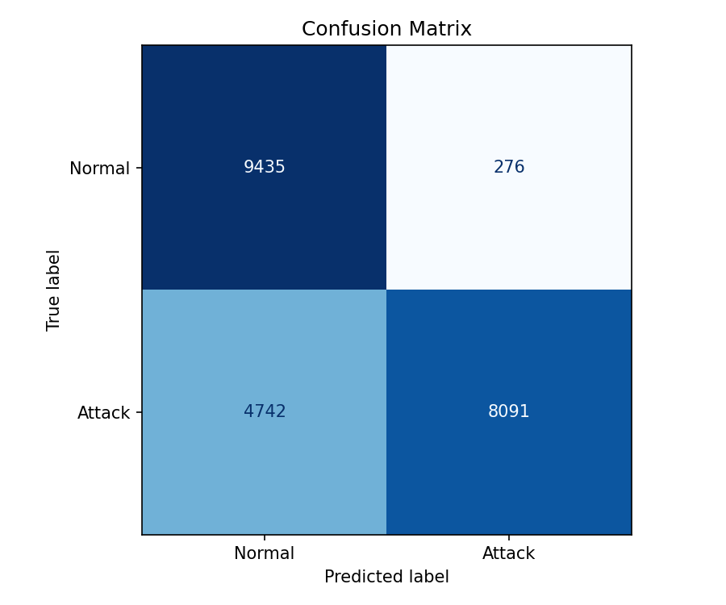
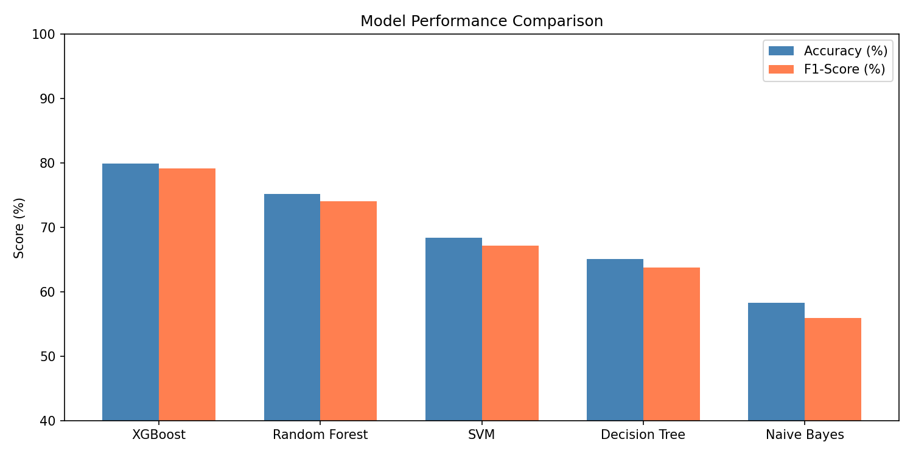
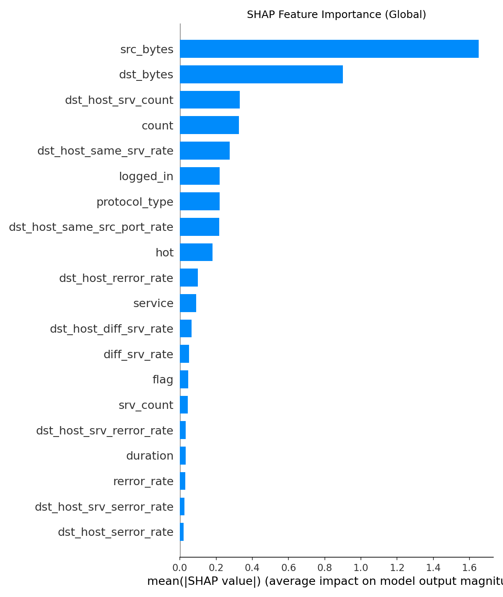

# Explainable NIDS with XGBoost + SHAP

A web-based Network Intrusion Detection System that combines XGBoost with SHAP explainability to classify network traffic and explain each prediction in an interpretable way.

[](https://www.python.org/)
[](https://flask.palletsprojects.com/)
[](https://xgboost.readthedocs.io/)
[](https://shap.readthedocs.io/)

## Overview

This project is designed for security analytics and explainable AI in intrusion detection. It trains an XGBoost classifier on NSL-KDD data and exposes a Flask dashboard where users can:

- inspect model performance
- submit traffic samples for prediction
- view attack probabilities
- analyze SHAP feature contributions
- explore explainability results across multiple tabs

## Demo Screenshots

<p align="center">
  
  
  
</p>

## Key Features

- Multi-class intrusion detection with XGBoost
- Flask backend and lightweight vanilla JS frontend
- SHAP-based explanation for each prediction
- Feature importance and summary plots
- Real-time traffic inspection panel
- Ready-to-run project structure for local demos and research use

## Quick Start

### 1. Clone the repository

```bash
git clone https://github.com/remurumalik-debug/nids_xgboost_shap.git
cd nids_xgboost_shap
```

### 2. Create and activate a virtual environment

```bash
python -m venv .venv
```

Windows:

```powershell
.venv\Scripts\Activate.ps1
```

macOS/Linux:

```bash
source .venv/bin/activate
```

### 3. Install dependencies

```bash
pip install -r requirements.txt
```

### 4. Run the app

Option A: single launcher

```bash
python run.py
```

Option B: Windows batch file

```cmd
run.bat
```

Option C: manual Flask startup

```bash
cd flask_backend
python train.py
python app.py
```

Then open:

```text
http://localhost:5050
```

## Project Structure

```text
nids_xgboost_shap/
├── README.md
├── requirements.txt
├── run.py
├── run.bat
├── app.py
├── nids.py
├── KDDTrain+.txt
├── KDDTest+.txt
├── confusion_matrix.png
├── model_comparison.png
├── shap_summary.png
├── flask_backend/
│   ├── app.py
│   ├── train.py
│   ├── requirements.txt
│   ├── data/
│   ├── model/
│   ├── static/
│   └── templates/
├── pages/
├── utils/
├── model/
└── database/
```

## Model Performance

The project was evaluated on the NSL-KDD benchmark using the provided test set.

| Metric | Train | Validation | Test (KDDTest+) |
| --- | --- | --- | --- |
| Accuracy | ~100% | ~99% | 78.9% |
| Precision | ~100% | ~99% | 97% |
| Recall | ~100% | ~99% | 65% |
| F1-Score | ~100% | ~99% | 78% |
| ROC-AUC | ~1.0 | ~1.0 | 0.97 |

## Technologies Used

- Python
- Flask
- XGBoost
- SHAP
- scikit-learn
- pandas
- NumPy
- Joblib
- HTML/CSS/JavaScript

## Dataset

This project uses the NSL-KDD dataset:

- `KDDTrain+.txt`
- `KDDTest+.txt`

The data is processed and used for training, validation, evaluation, and explainability analysis.

## How it Works

1. Load and preprocess the NSL-KDD data
2. Train an XGBoost classifier
3. Evaluate the model on validation and test data
4. Compute SHAP values for interpretability
5. Expose model predictions and explanations via a Flask dashboard

## License

Academic project developed for research and educational purposes.

Final Year Project — Faculty of Computing and Informatics  
Confluence University of Science and Technology, Osara